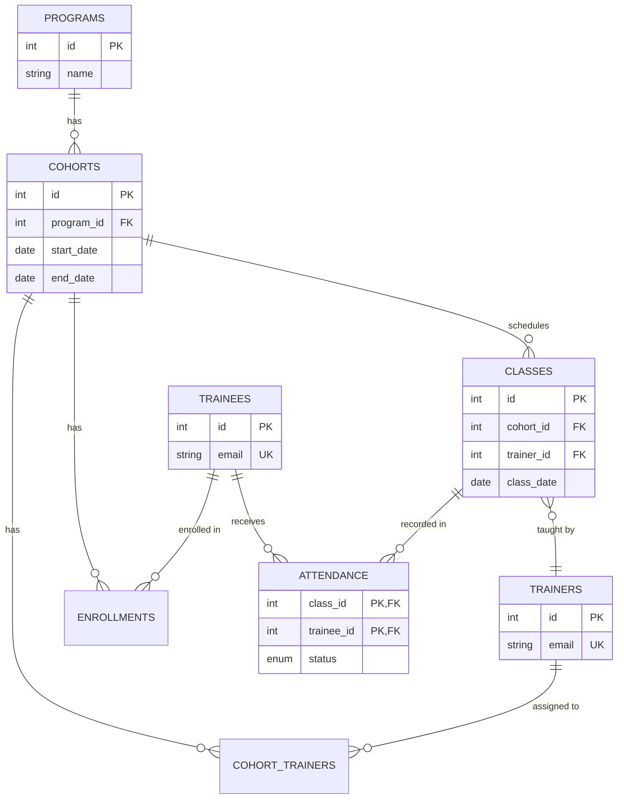

# System Architecture & Design Document

## 1. Interpretations & Relationships
Here is how I interpreted the core domains of the system and how they interact:
* **Program:** The high-level curriculum or overarching track (e.g., "Backend Engineering"). It serves as a parent category.
* **Cohort:** A specific, time-bound execution of a Program (e.g., "Backend Fall 2026"). It requires a valid timeline (Start Date -> End Date).
* **Trainer:** An instructor. They act as independent entities who can be assigned to multiple cohorts simultaneously.
* **Trainee:** A student. Like trainers, they exist independently and can be enrolled in multiple cohorts over time.
* **Class:** A single instructional session. It belongs to one Cohort, occurs on a specific Date, and is taught by one assigned Trainer.
* **Attendance:** The intersection of a Trainee, a Class, and a Status (Present, Absent, Late, Excused). 

**How they relate:** A Program has many Cohorts. Trainers and Trainees have Many-to-Many relationships with Cohorts (handled via junction tables). A Cohort has many Classes. A Class has many Attendance records (one per Trainee).

---

## 2. Data Model Diagram
Below is the Entity-Relationship Diagram modeling the database schema.

---

## 3. Business Rule Enforcement

My primary design philosophy is **Database-Driven Integrity**. Rules are enforced at the lowest possible level to prevent bad data from race conditions, API bugs, or direct database manipulation.

* **Rule:** *Cohorts must have valid timelines (End Date > Start Date).*
  * **Where:** Database (`CHECK (end_date > start_date)`).
  * **Why:** To absolutely prevent illogical timelines from ever being written to disk, regardless of frontend or API validation failures.
* **Rule:** *A Trainer must be assigned to a Cohort to teach a Class in it.*
  * **Where:** Database (Composite Foreign Key linking `classes.trainer_id` to the `cohort_trainers` junction table).
  * **Why:** Relational strictness prevents "rogue" classes taught by unauthorized personnel.
* **Rule:** *Valid Attendance Statuses Only.*
  * **Where:** Database (Custom `ENUM ('Present', 'Absent', 'Late', 'Excused')`).
  * **Why:** Prevents string variations/typos (e.g., 'absent' vs 'Absent') at the storage layer.
* **Rule:** *Batch Attendance Corrections / No Duplicates.*
  * **Where:** Database (`ON CONFLICT DO UPDATE` / Upsert).
  * **Why:** Idempotency. Sending the same attendance payload twice should not crash the app or create duplicates, it should just safely update the `updated_at` timestamps.
* **Rule:** *Attendance Rate Calculation.*
  * **Where:** API Layer (Python logic).
  * **Why:** Grading formulas are derived business metrics, not raw data storage concerns. This allows us to adjust how weights are calculated in the future without altering schemas.

---

## 4. Assumptions Made
Where the brief was left open to interpretation, I made the following assumptions:
1. **Attendance Weighting:** I assumed a fair grading system where "Late" is worth partial credit (0.5) and "Excused" completely removes the class from the denominator so a student is not mathematically penalized for a medical absence.
2. **Overlapping Enrollments:** I assumed a Trainee could theoretically be enrolled in multiple Cohorts at thesame time (e.g., taking Backend and Frontend simultaneously), hence the use of an `enrollments` junction table rather than tying a trainee directly to a single cohort.
3. **Class Topics:** I assumed that while classes happen on dates, topics are optional. Sometimes a class is just "Day 4", so the `topic` field is nullable.
4. **Recording vs. Teaching:** I assumed the trainer teaching the class might be different from the trainer recording the attendance (e.g., a TA recording for a lead instructor), so the attendance table tracks `recorded_by_trainer_id` separately.

---

## 5. Next Steps (With More Time)
If given an additional sprint to expand this project for a production environment, I would prioritize:
1. **Authentication & Authorization (JWT):** Implement proper user login. Trainers would only be able to view and modify cohorts they are explicitly assigned to. 
2. **Pagination:** Add cursor-based or offset pagination to all `GET` lists (Trainees, Classes) to prevent massive payloads as the dataset grows.
3. **Soft Deletes:** Add an `is_active` boolean or `deleted_at` timestamp to entities instead of allowing hard deletions, preserving historical data for audits.
4. **Automated Testing:** Implement a comprehensive `pytest` suite for the FastAPI endpoints and integrate it into a GitHub Actions CI pipeline.
5. **Dockerization:** Create `Dockerfile` and `docker-compose.yml` configurations to instantly spin up the API, Frontend, and PostgreSQL instances in isolated containers.